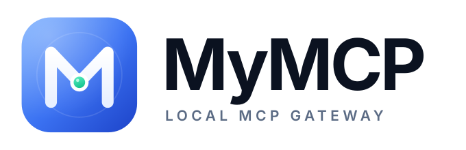

<p align="center">
  <picture>
    <source media="(prefers-color-scheme: dark)" srcset="docs/logo-dark.svg">
    
  </picture>
</p>

<p align="center">
  <a href="README.md">English</a> · <a href="README_zh.md">简体中文</a>
</p>

# MyMCP

## Project Overview

`mymcp` is a local-first MCP gateway written in Go. One local endpoint serves
every MCP client, with configuration sync, encrypted secrets, OAuth, usage
analytics and JavaScript client adapters.

The repository includes:

- `mcp-manager`: the native desktop app, built with
  [MyGo](https://github.com/egoist/mygo). It lives in the menu bar and keeps the
  gateway running after the window closes.
- `mymcp`: the local gateway daemon and CLI.
- `mcp-pipe`, `mcp-router`, `mcp-debug`: the original MCP pipe, router and
  debugging tools.

## Highlights

- **One endpoint per profile** — clients connect to
  `http://127.0.0.1:8422/mcp/<profile>`, and MyMCP aggregates the profile's
  stdio, HTTP and SSE servers.
- **Router or Direct sync** — write one router entry into an agent's config, or
  write every server directly. Direct mode refuses `secret://` references.
- **Encrypted secrets** — values live in `secrets.enc` with AES-256-GCM and are
  referenced from configs as `secret://name`.
- **OAuth** — authorization code + PKCE, token refresh, RFC 9728/8414 discovery
  and dynamic client registration.
- **Usage and access control** — SQLite usage records, per-client gateway keys,
  rate limits, HTTPS/mTLS and a Docker sandbox executor.
- **Portable profiles** — export and import signed profile bundles without
  copying secret values.
- **JavaScript adapters** — add a new client with `render`, `load` and `detect`
  hooks running in [moejs](https://github.com/Calcium-Ion/moejs).
- **Native UI** — Chinese and English, light and dark themes, with Overview,
  Servers, Profiles, Catalog, Clients, Debug, Secrets, Plugins, Usage and
  Settings pages.

## Direction

MyMCP is a **local-first MCP gateway**: every client shares one endpoint,
configuration sync, secret management and usage analytics. The research,
competitive landscape and architecture are in
[docs/mcp-gateway-design.md](docs/mcp-gateway-design.md). JavaScript client
adapters are documented in [docs/plugins.md](docs/plugins.md). MVP scope, verification and known
limitations are in [docs/mvp-readiness.md](docs/mvp-readiness.md).

## Download

Prebuilt desktop apps and CLI archives are published on the
[Releases](https://github.com/tk103331/mymcp/releases) page.

## Directory Structure

```
.
├── cmd/                    # Command-line and desktop entry points
│   ├── mcp-debug/          # MCP Server debugging
│   ├── mcp-manager/        # Desktop app entry point (MyGo)
│   ├── mcp-pipe/           # MCP pipe, sse2sse / sse2stdio / stdio2sse / stdio2stdio
│   ├── mcp-router/         # MCP router, with router.json
│   └── mymcp/              # Local gateway daemon and CLI
├── internal/
│   ├── app/                # Native UI: pages, dialogs, client config, catalog
│   ├── configsync/         # Client adapters, plan/apply/detach, imports
│   ├── data/               # Local data and JSON settings
│   ├── gateway/            # MCP aggregation, auth, usage endpoints
│   ├── importer/           # Import servers from existing agents
│   ├── manager/            # Legacy workspace runtime
│   ├── model/              # Server configuration shared by every tool
│   ├── oauth/              # OAuth discovery, login and token refresh
│   ├── plugin/             # JavaScript adapters on the moejs runtime
│   ├── portable/           # Signed profile bundle export/import
│   ├── proxy/              # MCP proxy and SSE transport
│   ├── secrets/            # Encrypted secret vault
│   └── store/              # SQLite registry and usage storage
├── docs/                   # Architecture, plugin docs and logo
├── examples/plugin-demo/   # Example JavaScript client adapter
├── locales/                # English and Chinese UI messages
├── resources/              # App icon and generated platform helpers
├── scripts/                # Build helpers, including bundled mcp-pipe
├── .github/workflows/      # CI and release automation
├── mygo.json               # Desktop app name, version and build settings
├── Makefile                # Build scripts and common commands
└── go.mod / go.sum         # Go module dependencies
```

## Requirements

- Go 1.27 or later. MyGo builds the desktop app and downloads its toolchain
  when missing.
- macOS 12 or later, Windows 10/11, or Linux with GTK 3 for the desktop app.
- The desktop app and CLI keep their data in `~/.mymcp`: `settings.json`,
  `mymcp.db`, `secrets.enc`, `master.key`, `sync.json`, `backups/` and
  `plugins/`.

## Local gateway

```sh
make mymcp
bin/mymcp add demo -- python3 ./fake-mcp.py
bin/mymcp add github --url https://api.githubcopilot.com/mcp/
bin/mymcp secret set github/token          # read from stdin
bin/mymcp serve                            # http://127.0.0.1:8422
bin/mymcp client apply cursor              # write the router entry
bin/mymcp client apply cursor --direct     # or write every server directly
bin/mymcp client plan cursor               # preview, then apply
bin/mymcp client restore cursor            # put back the last backup
bin/mymcp usage --stats
bin/mymcp key create cursor --profile default --rate 60
bin/mymcp oauth discover github            # RFC 9728/8414 + dynamic registration
bin/mymcp oauth login github               # authorization code + PKCE
bin/mymcp oauth status github
bin/mymcp import --client cursor
bin/mymcp plugin install ./examples/plugin-demo
bin/mymcp profile export default --output work.mymcp.json --sign-key bundle.key
bin/mymcp profile import work.mymcp.json --name shared --verify-key bundle.pub
bin/mymcp profile keygen --private bundle.key --public bundle.pub
bin/mymcp add docker-demo --executor docker --image mcp/demo --network none
bin/mymcp doctor
```

Profile bundles carry `secret://` references, not values; exporting refuses
literal token/password/authorization fields until they are stored as secrets.

Restart `mymcp serve` after changing servers or profiles; the desktop app has a
Restart button on the Overview page.

The desktop app has:

- **Overview** — gateway health, endpoint, server/tool/client counts, recent
  calls and quick actions.
- **Servers** — add, import, edit, enable/disable and delete upstream servers;
  see their profiles and startup errors.
- **Profiles** — create profiles, attach servers, copy profile endpoints, and
  manage client keys.
- **Catalog** — add a server from the bundled catalog into a profile.
- **Debug** — inspect aggregated tools, edit JSON arguments, call them through
  the running gateway, and see the response and latency.
- **Clients** — detect installed clients, preview and apply the router entry,
  or detach it. Entries changed after MyMCP wrote them are marked.
- **Secrets** — store encrypted API keys and tokens referenced as
  `secret://name`.
- **Plugins** — install, reload and remove JavaScript client adapters.
- **Usage** — calls, errors, latency and recent activity from the same SQLite
  data.
- **Settings** — language, theme, launch at login and the gateway address.

The daemon also exposes `/dashboard` for local usage, `/api/usage/*` as JSON
and `/metrics` for Prometheus. `--tool-search` replaces large tool lists with
`mymcp_find_tools`/`mymcp_call_tool`. `serve --tls-cert/--tls-key` enables
HTTPS, and `--client-ca` requires client certificates. `key create` issues
per-client keys; remote requests always need one, and local requests need one
with `--require-key`.

The client importer reads JSON, JSONC, TOML and YAML configurations, skips
duplicates and ignores MyMCP's own router entries and `mcp-pipe` bridges.

Claude Desktop, Codex, Kiro and Zed use the `mcp-pipe` bridge. Desktop builds
bundle `mcp-pipe`; the app copies it to `~/.mymcp/bin/mcp-pipe` and writes that
absolute path into client configs, so it does not need to be on `PATH`. OAuth
servers can be signed in from the server editor; the token is stored in the
secret vault.

## Build

```sh
make mymcp                          # local gateway CLI into bin/
make mcp-debug mcp-pipe mcp-router  # other CLI tools into bin/
make mcp-manager                    # MyGo app into build/, with bundled mcp-pipe
make dev                            # run the desktop app, rebuilt on changes
make test                           # go test ./...
```

`make mcp-manager` builds the platform `mcp-pipe` helper first; running
`go tool mygo build` directly uses an existing helper or falls back to
`mcp-pipe` on `PATH`.

`mcp-manager` uses [MyGo](https://github.com/egoist/mygo) and draws its
interface natively, with no web frontend. Its configuration lives in
`mygo.json`, and the UI messages are in `locales/en.json` and
`locales/zh-Hans.json`. The interface switches between Chinese and English, and
follows the system appearance or forces light/dark; a theme change applies
immediately.

## Release

1. Bump `version` in `mygo.json`.
2. Commit and push the change.
3. Tag the commit and push the tag:

```sh
git tag v0.3.1
git push origin v0.3.1
```

[`.github/workflows/release.yml`](.github/workflows/release.yml) checks the tag
against `mygo.json`, runs the tests and builds the desktop apps and CLI
archives. It publishes them with SHA-256 checksums on the GitHub release. The
macOS app is ad hoc signed until a Developer ID signing and notarization setup
is added.

## License

MIT — see [LICENSE](LICENSE).

## Contribution & Development

Contributions via Issues and PRs are welcome. Please follow best practices for
Go projects.
