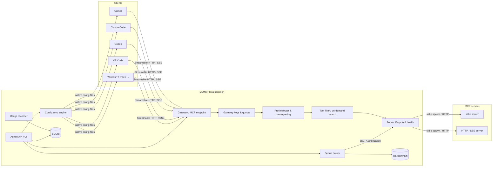

# MyMCP 本地 MCP 网关设计

> 状态：调研与方案 v0.1 · 2026-11-10
>
> 关键词：local-first、MCP gateway、配置同步、密钥管理、用量统计、工具搜索
>
> MVP 范围、验证记录和已知限制见 [mvp-readiness.md](mvp-readiness.md)。

## 0. 结论摘要

现有开源项目大致分成三类，各解决一段问题：

1. **传输代理**：`mcp-proxy`、`Supergateway`、`mcpo`，只做 stdio/SSE/HTTP 转换。
2. **聚合网关**：Docker MCP Gateway、IBM ContextForge、MetaMCP、MCPHub、MCPJungle、ToolHive、
   agentgateway、1MCP，重点是统一端点、鉴权、限流、可观测性和多服务器路由。
3. **本机配置/用量工具**：Magpie、Universal MCP Sync、MCP Server Manager、mcpspan，分别解决
   “一次配置同步到多个客户端”和“MCP 调用分析”。

**没有项目同时把这三件事做好：**

- 配置同步工具通常不管运行时，密钥仍以明文写进各客户端配置。
- 网关通常面向团队/集群部署，不负责导入和同步本机 Cursor、Claude Code、Codex 等已有配置。
- 用量统计要么依赖服务端 SDK 埋点，要么属于企业审计平台；本机网关级别的调用统计很少。

MyMCP 的定位应该是：

> **开发者本机的 MCP 控制面：一次配置、所有客户端复用；上游密钥不出本机；每次工具调用都可观察。**

默认采用 **Router 模式**：每个客户端只写一条 `mymcp` 配置，真正的服务器、凭据、路由、统计都在本地守护进程里。
需要兼容时保留 **Direct 模式**，由 MyMCP 把单个服务器直接写入客户端配置。

---

## 1. 目标与非目标

### 1.1 目标

1. **配置一次，处处可用**
   - 自动发现并导入已有客户端配置。
   - 维护唯一的服务器/Profile 注册表。
   - 生成各客户端原生格式，支持预览、备份、回滚。
   - 检测客户端配置漂移并提供修复。
2. **密钥不落地到客户端配置**
   - 上游 API Key、OAuth Token、Bearer Header、stdio 环境变量统一托管。
   - 客户端只拿到本地网关地址和本地网关 Key。
   - 密钥存储在系统钥匙串，SQLite 只保存引用和元数据。
3. **可观察**
   - 按客户端、服务器、工具记录调用量、成功率、延迟、错误、请求/响应体积。
   - 默认不记录参数和结果内容。
   - 本地仪表盘、SQLite 查询、Prometheus/OTel 导出。
4. **本机优先**
   - 单二进制、无外部数据库、离线可用。
   - macOS/Windows/Linux 托盘常驻，客户端自动接入。
   - 不要求 Docker、Kubernetes 或云账号。

### 1.2 非目标（第一阶段）

- 不做多租户企业控制面；不做团队 RBAC、SSO、K8s Operator。
- 不做模型/LLM 网关（不代理 OpenAI/Anthropic 请求），只做 MCP。
- 不做 MCP 服务器市场；消费官方 Registry、Docker Catalog、Smithery 等现有来源。
- 不强制容器隔离；容器/沙箱作为后续可选执行器。
- 不记录 MCP 请求/响应正文作为默认行为。

---

## 2. 开源项目调研

星标数为 2026-11-10 查询，仅用于量级参考。

### 2.1 分类与代表项目

| 类别 | 项目 | 语言 / Star | 主要能力 | 与本项目的关系 |
|---|---|---|---|---|
| 传输桥 | [mcp-proxy](https://github.com/sparfenyuk/mcp-proxy) | Python / 2.8k | stdio ↔ SSE/Streamable HTTP | 传输层参考 |
| 传输桥 | [Supergateway](https://github.com/supercorp-ai/supergateway) | TS / 3.0k | stdio 包装成 HTTP/SSE | 传输层参考 |
| 传输桥 | [mcpo](https://github.com/open-webui/mcpo) | Python / 4.4k | MCP → OpenAPI | 非核心 |
| 本机聚合 | [1MCP](https://github.com/1mcp-app/agent) | TS / 0.5k | 统一运行时、preset、过滤、lazy loading、stdio proxy | 路由/工具面参考 |
| 聚合网关 | [TBXark/mcp-proxy](https://github.com/TBXark/mcp-proxy) | Go / 0.7k | 多服务器聚合到单 HTTP | 聚合参考 |
| 聚合网关 | [MCPJungle](https://github.com/mcpjungle/MCPJungle) | Go / 1.6k | 自托管注册表、访问控制、可观测钩子 | 轻量网关参考 |
| 聚合网关 | [Docker MCP Gateway](https://github.com/docker/mcp-gateway) | Go / 1.6k | Catalog、Profile、统一网关、Docker Desktop secrets、OAuth | 产品化/Profile 参考 |
| 控制面 | [IBM ContextForge](https://github.com/IBM/mcp-context-forge) | Python / 4.8k | MCP/A2A/REST 联邦、注册表、鉴权、限流、OTel、Admin UI | 企业能力参考 |
| 控制面 | [MetaMCP](https://github.com/metatool-ai/metamcp) | TS / 2.8k | Namespace 聚合、Middleware、API Key/OAuth、env 引用 | 分组/中间件参考 |
| 控制面 | [MCPHub](https://github.com/samanhappy/mcphub) | TS / 2.7k | 自托管网关、per-user credentials、OAuth、日志/延迟/健康 | 凭据与日志参考 |
| 控制面 | [ToolHive](https://github.com/stacklok/toolhive) | Go / 2.3k | 容器隔离、Gateway、Registry、加密密钥、OTel/Prometheus | 隔离/可观测参考 |
| 控制面 | [Obot](https://github.com/obot-platform/obot) | Go / 1.2k | MCP+LLM 网关、身份、Secrets、审计、Token/成本统计 | 审计/密钥参考 |
| 控制面 | [agentgateway](https://github.com/agentgateway/agentgateway) | Rust / 6.1k | MCP/A2A/LLM 代理、JWT/OAuth/RBAC、CEL、OTel | 高性能代理参考 |
| 本机配置 | [Magpie](https://github.com/yetone/magpie) | Go / 33.7k | 多 Agent 配置同步、MCP Router、工具搜索、请求日志 | **最接近，重点对标** |
| 本机配置 | [Universal MCP Sync](https://github.com/nawodyaishan/universal-mcp-sync) | Go / 少量 | plan/apply、多客户端原生格式、JSONC 保留、stdio bridge | 配置同步参考 |
| 本机配置 | [MCP Server Manager](https://github.com/vlazic/mcp-server-manager) | Go / 少量 | YAML 单一配置、HTMX UI、跨平台单二进制 | 轻量管理参考 |
| 用量分析 | [mcpspan](https://github.com/mcpspan/mcpspan) | TS / 少量 | MCP 服务端 SDK 埋点、自托管分析面板 | 统计模型参考 |
| 用量分析 | [tokenchit](https://github.com/iyashjayesh/tokenchit) | TS / 少量 | 读取本地 Agent 日志，Token/模型统计 | 本地日志参考 |

图例：● 明确支持，◐ 部分支持/需要额外配置，○ 未发现。

### 2.2 能力对比

| 项目 | 本机优先 | 配置同步 | 密钥托管 | 调用统计 | 运行时网关 | GUI |
|---|---|---|---|---|---|---|
| Magpie | ● | ●（大量 Agent） | ◐（模型密钥/MCP OAuth） | ●（请求日志、模型用量） | ●（MCP Router） | ● |
| Docker MCP Gateway | ●（需 Docker） | ◐（Profile/Catalog，不改已有客户端） | ●（Docker Desktop secrets） | ○ | ● | ◐ |
| ContextForge | ◐ | ○ | ◐ | ●（OTel） | ● | ● |
| MetaMCP | ◐ | ○ | ◐（env 引用） | ○ | ● | ● |
| MCPHub | ◐ | ○ | ●（加密 per-user credentials） | ◐（日志/延迟） | ● | ● |
| ToolHive | ◐（容器） | ○ | ●（加密 secrets） | ●（OTel/Prometheus） | ● | ● |
| Obot | ◐ | ○ | ● | ●（审计/Token） | ● | ● |
| agentgateway | ○ | ○ | ◐ | ●（OTel） | ● | ◐ |
| 1MCP | ● | ○ | ○ | ○ | ● | ○ |
| Universal MCP Sync | ● | ● | ◐（凭据输入） | ○ | ○ | ●（TUI） |
| MCP Server Manager | ● | ◐（YAML） | ○ | ○ | ◐ | ● |
| mcpspan | ◐（自托管） | ○ | ○ | ● | ○ | ● |

### 2.3 关键发现

1. **“配置同步”和“运行时网关”是两条产品线**
   - Magpie 和 Universal MCP Sync 证明开发者愿意让工具改本机配置，但前者绑定在模型网关产品里，后者没有运行时。
   - Docker/ContextForge/MCPHub 等网关能力强，但不会帮你把现有 Cursor/Claude Code 配置迁移过来。
2. **本地密钥管理仍是空白**
   - 多数项目靠 `${ENV}`、Docker secrets 或企业 Vault；客户端 JSON 里依然可能出现明文。
   - Router 模式是解决该问题的关键：客户端只保存网关地址，上游凭据完全不进入客户端文件。
3. **用量统计通常要求“把服务器接进平台”**
   - mcpspan 需要给服务器加 SDK；企业网关有 OTel，但不适合本机个人使用。
   - 如果 MyMCP 是网关，它天然在调用路径上，可以在不改服务器的情况下记录调用。
4. **上下文膨胀已经成为共识**
   - Magpie 的 `find_tools`/`call_tool` 按需暴露工具，1MCP 的 lazy loading、ToolHive 的工具裁剪都在解决同一问题。
   - 统计里应该直接展示“工具 schema 体积/估算 Token”和“未被使用的工具”。
5. **OAuth 是远程 MCP 的准入线**
   - Docker、ContextForge、MCPHub、ToolHive、Obot 都支持 OAuth。
   - 本地工具不应要求用户手工复制短期 Access Token。
6. **本机 UX 是差异化**
   - 托盘图标、一次导入、diff 预览、备份回滚、配置漂移修复、Doctor 诊断，这些比“又一个企业网关”更有价值。

---

## 3. 产品设计

### 3.1 用户与场景

- **个人开发者**：同时使用 Cursor、Claude Code、Codex、VS Code、Windsurf 等多个客户端。
- **多项目开发者**：不同项目需要不同的 MCP 工具集合。
- **工具作者/重度用户**：几十个 MCP 服务器、多个 API Key，需要知道哪些工具真的被调用。
- **小团队（后续）**：共享一个局域网网关，但不希望部署 Kubernetes。

核心流程：

1. **首次启动**：扫描已安装客户端和现有 MCP 配置 → 生成导入计划 → 用户确认。
2. **接入新客户端**：选择客户端 → 预览将写入的配置 → 应用（自动备份）。
3. **添加服务器**：从 Registry/Catalog、JSON 粘贴或手动填写；选择 Profile。
4. **配置密钥**：输入 API Key/OAuth 登录；保存到系统钥匙串；客户端配置不变。
5. **日常使用**：客户端连接 `mymcp` 端点；服务器按需启动；调用记录进入本地数据库。
6. **排查问题**：Doctor 检查配置漂移、密钥缺失、进程失败、端口冲突；Usage 页面定位错误和慢调用。

### 3.2 两种接入模式

| 模式 | 客户端配置 | 适用 | 优点 | 缺点 |
|---|---|---|---|---|
| **Router（默认）** | 每个客户端一条 `mymcp` 服务器，指向本地网关 | 大多数 HTTP MCP 客户端 | 配置最少；密钥不出本机；统一统计；服务器只启动一次 | 依赖网关运行；需要客户端支持 HTTP |
| **Direct** | 把单个服务器按原生格式写入客户端 | 只支持 stdio 的客户端、调试、兼容 | 不依赖网关；接近原生体验 | 配置多；密钥可能落到客户端；无法统一统计 |

Direct 模式仍然可以由 MyMCP 管理写入和密钥注入（例如生成 wrapper 命令），但不承诺完全隐藏密钥。

### 3.3 信息架构（UI）

- **Overview**：网关状态、今日调用、错误率、运行中的服务器、最近客户端。
- **Servers**：服务器列表、健康状态、工具数、最近调用、启动/停止、编辑。
- **Profiles**：按项目/用途分组；每个 Profile 是一个 MCP 端点。
- **Clients**：已检测客户端、接入模式、配置路径、同步状态、漂移告警、修复按钮。
- **Secrets**：密钥条目（只显示名称/类型/最后使用时间）、轮换、引用位置。
- **Usage**：时间序列、按客户端/服务器/工具、错误、延迟、工具 schema 体积、未使用工具。
- **Settings**：端口、自动启动、保留期、隐私（是否记录内容）、导出。

托盘菜单：打开主窗口、网关开关、Profile 快速切换、暂停所有服务器、复制端点、退出。

---

## 4. 总体架构



### 4.1 进程模型

- **单守护进程**：托盘应用内启动，或 `mymcp serve` 独立运行。
- **UI**：MyGo 原生界面，通过本地 Admin API 访问守护进程；CLI 复用同一 API。
- **MCP 端点**：默认 `127.0.0.1:0`（随机端口）或固定端口；写进客户端配置后保持稳定。
- **生命周期**：托盘退出时优雅关闭所有 stdio 子进程；崩溃后下次启动恢复。
- **单实例锁**：避免两个守护进程抢端口/配置。

### 4.2 建议目录

```text
cmd/mymcp/                 # 守护进程 / CLI / 托盘入口
internal/
  gateway/                 # MCP HTTP/SSE/Streamable HTTP、session、路由
  router/                  # profile、命名空间、工具过滤/搜索
  lifecycle/               # stdio 进程、健康检查、懒启动、idle 回收
  configsync/              # 客户端发现、格式化、plan/apply、备份、漂移
  secrets/                 # keychain、加密文件、OAuth token、引用解析
  usage/                   # 事件、SQLite、聚合、Prometheus/OTel 导出
  auth/                    # 网关 Key、scope、配额
  registry/                # 服务器/Profile/客户端数据模型与存储
  admin/                   # Admin HTTP API
  app/                     # MyGo 原生 UI（现有）
  proxy/                   # 现有传输实现，保留并复用
```

### 4.3 存储布局

```text
~/.mymcp/
  mymcp.db                 # SQLite：服务器、客户端、用量、同步记录
  config.json              # 端口、隐私、保留期等
  logs/                    # 结构化日志（脱敏）
  backups/                 # 客户端配置备份（按时间戳）
  run/                     # pid、socket、锁
```

**密钥不进入 `mymcp.db`。**

---

## 5. 关键设计

### 5.1 配置同步引擎

核心接口：

```go
type Adapter interface {
    ID() string
    Detect() ([]Location, error)
    Read(path string) (Document, error)
    Render(profile Profile, servers []Server, mode Mode) (Document, error)
    Plan(path string, next Document) (Diff, error)
    Apply(path string, next Document, opts ApplyOptions) error
    Restore(path string, backup string) error
}
```

**流程**：`detect → read → plan → apply`。

- **发现**：按平台扫描已知客户端路径；读取现有 `mcpServers`/`servers`/`context_servers`/TOML/YAML。
- **导入**：把已有条目转换成统一 `Server`，保留原始名称；记录来源和文件位置。
- **渲染**：根据客户端格式生成条目：
  - JSON：`mcpServers` / `servers` / `context_servers` / `mcp`
  - TOML：Codex `[mcp_servers.*]`
  - YAML：Goose 等
  - 远程：`url` / `serverUrl` / `httpUrl` / `serverUrl` + type
  - stdio：`command` / `args` / `env`
- **所有权**：只修改 MyMCP 写入的条目，不覆盖用户手写的内容。
  - 在 `client_entries` 表记录：客户端、文件、条目名、写入哈希、模式。
  - 用户修改过的条目（哈希不一致）在 Plan 中标记为“冲突”，不自动覆盖。
- **安全写入**：
  - 文件锁 + 临时文件 + `rename` 原子替换。
  - 写入前备份到 `backups/<client>/<timestamp>`。
  - JSONC 保留注释（surgical edit）；TOML 使用 AST/局部编辑；至少保留未知键。
  - 失败可一键回滚。
- **漂移检测**：文件 mtime/hash 变化时提示“客户端配置已被修改”，提供 diff 和三选一：保留客户端改动 / 覆盖为 MyMCP / 取消托管。
- **卸载**：只移除 MyMCP 条目，并恢复原始片段。

**客户端适配优先级**：
Cursor、Claude Code、Claude Desktop、VS Code、Codex、Windsurf、Trae、Gemini CLI、OpenCode、Cline、Kiro、Qoder、Crush、LM Studio。

### 5.2 路由与工具面

- **Profile**：一组服务器的逻辑集合，例如 `default`、`work`、`research`。
- **端点**：
  - `POST /mcp/{profile}`（Streamable HTTP）
  - `GET /mcp/{profile}/sse`（兼容 SSE）
  - `POST /mcp/{profile}/message`
  - `GET /mcp/{profile}/health`
- **客户端绑定**：每个客户端可绑定一个 Profile；默认 `default`。
- **工具命名**：`<server>__<tool>`，字符规范化，超过 64 字符截断并加序号，冲突去重。
- **工具过滤**：Profile 级别 allow/deny，按服务器或工具名。
- **按需工具搜索**：工具数超过阈值（默认 10）时，暴露：
  - `find_tools(query, server?)`
  - `call_tool(name, arguments)`
  - 或保留全量模式（按客户端/Profile 配置）。
  - 参考 Magpie 的评分策略和 1MCP 的 lazy loading，但保持 MCP 协议兼容。
- **传输**：
  - 上游 stdio：启动子进程，stdin/stdout JSON-RPC；进程组回收。
  - 上游 HTTP/SSE：连接池、headers 注入、session 恢复。
  - 对外统一 Streamable HTTP；SSE 作为兼容层。
- **懒启动 / 健康**：
  - `tools/list` 时才启动 stdio；缓存工具列表。
  - 空闲 10 分钟回收；下次调用自动重启。
  - 进程退出/超时归类为可读错误，返回给客户端。
- **错误语义**：包装为 MCP error，包含服务器名、阶段（启动/连接/调用/超时）和脱敏后的原因。

### 5.3 密钥管理

需要区分两类 Key：

| 类型 | 用途 | 存储 | 是否写入客户端配置 |
|---|---|---|---|
| **上游凭据** | 服务器 API Key、OAuth Token、Bearer Header、stdio env | 系统钥匙串 | Router 模式：否；Direct 模式：尽量用引用/包装器 |
| **下游网关 Key** | 客户端访问本地网关 | 钥匙串 + DB 哈希/scope | 是（本地随机 Key，可撤销） |

- **钥匙串**：
  - macOS：Security.framework（通过 purego，保持 `CGO_ENABLED=0`）
  - Windows：Credential Manager
  - Linux：Secret Service/libsecret；无桌面环境时回退到加密文件
  - 加密回退：XChaCha20-Poly1305，主密钥放钥匙串；文件权限 0600。
- **引用语法**：
  - 服务器配置只存 `secret://github/token`，不存值。
  - stdio 启动时解析为环境变量；HTTP 调用时解析为 header。
  - 引用在 DB 中保存 `provider + name + version`。
- **OAuth**：
  - 网关作为 OAuth Client，使用 loopback callback。
  - Token 存钥匙串；自动刷新；失败时在 UI 提示重新登录。
  - 支持 `Authorization: Bearer`、自定义 header、query token（仅兼容模式）。
- **轮换**：修改密钥后 Router 模式无需改客户端配置；Direct 模式触发重新同步。
- **最小暴露**：
  - 默认只允许本机访问；网关 Key 绑定 loopback。
  - 日志/统计默认不记录 headers、env、参数值。
  - UI 只显示密钥名称、类型、最后使用时间。

### 5.4 用量统计

**记录点**：网关的 MCP 方法边界，而不是服务器内部。

事件字段：

```text
id, ts, client_id, key_id, profile_id, server_id, transport,
method (initialize/tools/list/tools/call/resources/read/prompts/get),
tool, status (ok/error/timeout/denied), error_code,
latency_ms, queue_ms, connect_ms,
request_bytes, response_bytes, session_id, trace_id,
args_hash, args_bytes
```

默认**不记录**参数与结果正文；可在设置中开启“调试内容”，并对敏感字段做脱敏/截断。

**指标**：

- 调用量：按分钟/小时/天；按客户端、服务器、工具。
- 健康：成功率、错误码分布、p50/p95/p99 延迟、超时率。
- 上下文成本：每个服务器的工具数、schema 字节数、估算 Token；未被调用的工具。
- 客户端：每个客户端的调用量、最后活跃时间、网关 Key 使用情况。
- 服务器：启动次数、崩溃次数、空闲回收次数。
- 节省：工具搜索/懒加载前后的 schema 体积对比。

**存储**：

- `calls` 原始表 + `daily_rollups` 聚合表。
- 默认保留 30 天原始、365 天聚合；可配置。
- 单文件 SQLite（纯 Go 驱动，保持跨平台无 cgo）；WAL 模式。
- 导出：CSV、JSON、Prometheus（`/metrics`）、OTel OTLP（span + metric）。

**隐私**：本地默认；不上传；可选匿名产品指标与调用统计分离。

### 5.5 安全

- 默认只监听 `127.0.0.1`；可选 Unix domain socket（macOS/Linux）和 named pipe（Windows）。
- 网关 Key：
  - 每个客户端独立 Key，可撤销、可设过期时间。
  - scope：Profile、服务器、工具、只读/可调用。
  - 配额：每分钟/每天调用数、并发数。
  - 哈希存储，不保存明文。
- 浏览器访问：
  - 校验 `Origin`，默认拒绝 `null` 和陌生站点。
  - 防 DNS rebinding：只接受 loopback Host。
- 上游 URL：
  - 允许 http/https；对私网地址、file://、重定向做策略控制。
  - 限制响应体大小和超时。
- 进程：
  - stdio 子进程独立进程组；退出时回收整个进程树。
  - 环境变量只注入需要的密钥；默认不继承敏感变量。
  - 可选容器/沙箱执行器（后续）。
- 审计：记录 Key 创建/撤销、密钥读取、配置写入、服务器启停；默认保留 90 天。

### 5.6 数据模型（SQLite 草案）

```sql
CREATE TABLE servers (
  id TEXT PRIMARY KEY,
  name TEXT NOT NULL UNIQUE,
  transport TEXT NOT NULL CHECK (transport IN ('stdio','http','sse')),
  command TEXT,
  args_json TEXT,
  url TEXT,
  env_refs_json TEXT,
  header_refs_json TEXT,
  enabled INTEGER NOT NULL DEFAULT 1,
  idle_seconds INTEGER NOT NULL DEFAULT 600,
  created_at INTEGER NOT NULL,
  updated_at INTEGER NOT NULL
);

CREATE TABLE secrets (
  id TEXT PRIMARY KEY,
  name TEXT NOT NULL UNIQUE,
  kind TEXT NOT NULL,              -- apikey | oauth | basic | env
  provider TEXT NOT NULL,          -- keychain | file | 1password | vault | env
  ref TEXT NOT NULL,
  metadata_json TEXT,
  created_at INTEGER NOT NULL,
  rotated_at INTEGER
);

CREATE TABLE profiles (
  id TEXT PRIMARY KEY,
  name TEXT NOT NULL UNIQUE,
  description TEXT,
  created_at INTEGER NOT NULL
);

CREATE TABLE profile_servers (
  profile_id TEXT NOT NULL,
  server_id TEXT NOT NULL,
  enabled INTEGER NOT NULL DEFAULT 1,
  tool_allow_json TEXT,
  tool_deny_json TEXT,
  PRIMARY KEY (profile_id, server_id)
);

CREATE TABLE clients (
  id TEXT PRIMARY KEY,
  kind TEXT NOT NULL,
  label TEXT NOT NULL,
  mode TEXT NOT NULL,              -- router | direct
  profile_id TEXT,
  managed INTEGER NOT NULL DEFAULT 0,
  last_sync_at INTEGER
);

CREATE TABLE client_entries (
  client_id TEXT NOT NULL,
  file TEXT NOT NULL,
  entry_name TEXT NOT NULL,
  format TEXT NOT NULL,
  hash TEXT NOT NULL,
  backup TEXT,
  written_at INTEGER NOT NULL,
  PRIMARY KEY (client_id, file, entry_name)
);

CREATE TABLE gateway_keys (
  id TEXT PRIMARY KEY,
  name TEXT NOT NULL,
  key_hash TEXT NOT NULL,
  scopes_json TEXT,
  quota_json TEXT,
  expires_at INTEGER,
  last_used_at INTEGER,
  created_at INTEGER NOT NULL
);

CREATE TABLE calls (
  id INTEGER PRIMARY KEY AUTOINCREMENT,
  ts INTEGER NOT NULL,
  client_id TEXT,
  key_id TEXT,
  profile_id TEXT,
  server_id TEXT,
  transport TEXT,
  method TEXT NOT NULL,
  tool TEXT,
  status TEXT NOT NULL,
  error_code TEXT,
  latency_ms INTEGER,
  queue_ms INTEGER,
  connect_ms INTEGER,
  request_bytes INTEGER,
  response_bytes INTEGER,
  session_id TEXT,
  trace_id TEXT,
  args_hash TEXT,
  args_bytes INTEGER
);
CREATE INDEX calls_ts ON calls(ts);
CREATE INDEX calls_server_tool ON calls(server_id, tool, ts);
```

### 5.7 API 与 CLI

**MCP 端点**

- `POST /mcp/{profile}` — Streamable HTTP
- `GET /mcp/{profile}/sse` — SSE 兼容
- `POST /mcp/{profile}/message`
- `GET /healthz`

**Admin API**

- `GET/POST /api/servers`
- `POST /api/servers/{id}/start|stop`
- `GET/POST /api/profiles`
- `GET /api/clients`
- `POST /api/clients/{id}/plan|apply|repair|detach`
- `GET/POST /api/secrets`（值只写不读）
- `POST /api/keys`
- `GET /api/usage/summary|timeseries|calls`
- `GET /metrics`

**CLI**

```sh
mymcp serve                      # 守护进程
mymcp add <name> -- <cmd...>     # 添加 stdio 服务器
mymcp add <name> --url <url>     # 添加远程服务器
mymcp client detect
mymcp client plan cursor
mymcp client apply cursor
mymcp secret set github/token
mymcp key create cursor --profile default
mymcp usage --by tool --since 7d
mymcp doctor
```

### 5.8 与现有代码的映射

| 现有 | 目标 |
|---|---|
| `internal/proxy` | 保留为传输适配层；补 Streamable HTTP、session 恢复 |
| `internal/manager` | 拆成 `lifecycle`（进程/健康）+ `gateway`（HTTP 路由） |
| `internal/data` | 迁移到 `registry` + SQLite；保留 JSON 导入兼容 |
| `internal/app` | 扩展 UI：Overview / Clients / Secrets / Usage |
| `internal/app/clients.go` | 变成 `configsync` 的客户端 Adapter |
| 工作空间 Workspace | 升级为 Profile；AutoRun/Disabled 语义保留 |
| `cmd/mcp-router` / `cmd/mcp-pipe` | 保留独立工具；网关复用其能力 |

---

## 6. 路线图

### 实现进度（2026-11-10）

- **M0 已完成**：SQLite 注册表/用量表、AES-GCM 密钥库、Profile 聚合网关
  （Streamable HTTP + SSE）、stdio/HTTP/SSE 上游、CLI（`serve`/`add`/`list`/
  `secret`/`usage`）、端到端测试。
- **M1 核心已完成**：`internal/configsync` 支持 Cursor、Windsurf、Trae、
  Claude Code、Claude Desktop、Codex、Gemini CLI、OpenCode、GitHub Copilot、
  Cline、Kiro、Qoder、Crush、VS Code、LM Studio、Factory Droid、Zed、Goose、
  Kimi Code、CodeBuddy、Antigravity 的 Router/Direct 条目写入；`plan/apply/detach`、备份、冲突检测、JSONC 读取、Codex TOML。
  UI 集成和 Direct 模式尚未完成。
- **M2 已完成**：空闲回收与自动重启、按需工具搜索
  （`mymcp_find_tools`/`mymcp_call_tool`）、Usage Dashboard
  （`/dashboard`、`/api/usage/*`）、Prometheus `/metrics`、`mymcp doctor`。
- **M3 部分完成**：每客户端网关 Key（创建/列表/吊销）、每 Key 速率限制、
  远程请求强制鉴权、`--require-key`；OAuth Broker（授权码 + PKCE、自动刷新、
  令牌存入密钥库、网关自动注入 Authorization；RFC 9728/8414 自动发现和动态
  客户端注册，`oauth discover`）；桌面 UI 已接入 Usage 页面
  （读取 `mymcp.db`）；Direct 模式配置同步（`client apply --direct`，拒绝携带
  `secret://` 的服务器）；HTTPS 与 mTLS（`--tls-cert/--tls-key/--client-ca`）。
  团队共享以可移植 Bundle 实现（`profile export/import`，只带 `secret://`
  引用不带密钥值，支持 Ed25519 签名/验签）；沙箱执行器（stdio 的 Docker 包装，`--executor docker --image … --network … --volume …`）；
  JavaScript 插件（moejs）可动态定义新的 Agent 适配器，
  提供 `render`/`load`/`detect`；CLI 支持 `plugin install/list/remove`，
  导入支持 `mymcp import` 并过滤 MyMCP 托管条目。桌面端插件页支持安装、重载、移除 JavaScript 适配器；网关控制页支持服务器新增/编辑（环境变量、Headers、OAuth、Sandbox）、
  启停/删除、客户端 Key 创建/吊销和 Profile 查看；Clients 页支持检测、
  预览、应用和断开客户端路由配置；另有 Usage 页。界面支持中英文，外观可跟随
  系统或强制浅色/深色，切换后立即生效。

### M0：基础骨架（约 1 周）

- SQLite 存储层与迁移。
- Secret 引用 + macOS Keychain（purego），文件加密回退。
- Profile 路由：一个 `/mcp/{profile}` 端点，聚合多个 stdio/HTTP 服务器。
- 基础 usage 记录（不记录内容）。
- CLI：`serve`、`add`、`usage`。

**验收**：Cursor 配置一条 `mymcp`，能调用两个服务器；重启后仍可用；密钥不在客户端文件中。

### M1：配置同步（约 2 周）

- 客户端 Adapter：Cursor、Claude Code、Claude Desktop、VS Code、Codex、Windsurf、Trae。
- 自动发现、导入、Plan/Diff、Apply、备份、回滚。
- Router / Direct 两种模式。
- UI：Clients 页面、同步预览、漂移提示。

**验收**：从零导入 5 个客户端的现有配置；添加服务器后一键同步；失败可回滚。

### M2：可观察与体验（约 2 周）

- 懒启动、健康检查、idle 回收、进程树清理。
- 工具命名空间、过滤、按需工具搜索。
- Usage 仪表盘：调用量、错误、延迟、Top 工具、工具 schema 体积、未使用工具。
- Prometheus/OTel 导出。
- Doctor：配置漂移、密钥缺失、端口冲突、进程失败。

**验收**：能定位“哪个客户端、哪个服务器、哪个工具、为什么失败/慢”；工具上下文体积下降。

### M3：远程与安全增强

- OAuth Broker（自动登录/刷新）。
- 每客户端网关 Key、scope、配额。
- LAN/远程访问、mTLS。
- 可选容器/沙箱执行器。
- 团队共享 Profile（后续）。

---

## 7. 风险与开放问题

1. **客户端格式持续变化**：Adapter 需要契约测试和版本探测；写入要保守。
2. **配置写入安全**：JSONC 注释、TOML 顺序、缩进、未知键、并发编辑；必须做备份和冲突检测。
3. **无 cgo 的钥匙串**：Linux Secret Service 依赖 D-Bus；无桌面环境需要加密文件回退。
4. **密钥引用能力差异**：部分客户端不支持变量引用；Router 模式是主要解法，Direct 模式要明确风险。
5. **工具命名冲突**：不同服务器同名工具；需要稳定命名和可逆映射。
6. **OAuth 复杂度**：动态注册、回调端口、刷新、撤销、企业 IdP。
7. **统计准确性**：MCP 协议没有 Token 字段；只能统计调用、字节、延迟，Token 需要估算。
8. **隐私**：默认不记录内容；调试模式需要脱敏、截断和明确提示。
9. **Windows 进程管理**：作业对象/进程树回收；路径与配置格式差异。
10. **默认模式选择**：Router 适合统一管理，但会让客户端依赖守护进程；Direct 适合调试和 stdio-only 客户端。

**建议默认**：Router 模式 + 每客户端 Key；Direct 作为高级选项。

---

## 8. 参考资料

- Magpie：<https://github.com/yetone/magpie>；MCP Router 设计：`docs/subsystems/mcp-router.md`
- Docker MCP Gateway：<https://github.com/docker/mcp-gateway>
- IBM ContextForge：<https://github.com/IBM/mcp-context-forge>
- MetaMCP：<https://github.com/metatool-ai/metamcp>
- MCPHub：<https://github.com/samanhappy/mcphub>
- MCPJungle：<https://github.com/mcpjungle/MCPJungle>
- ToolHive：<https://github.com/stacklok/toolhive>
- Obot：<https://github.com/obot-platform/obot>
- agentgateway：<https://github.com/agentgateway/agentgateway>
- 1MCP：<https://github.com/1mcp-app/agent>
- Universal MCP Sync：<https://github.com/nawodyaishan/universal-mcp-sync>
- MCP Server Manager：<https://github.com/vlazic/mcp-server-manager>
- mcpspan：<https://github.com/mcpspan/mcpspan>
- tokenchit：<https://github.com/iyashjayesh/tokenchit>
- MCP 官方 Registry：<https://github.com/modelcontextprotocol/registry>
- MCP 安全最佳实践：<https://modelcontextprotocol.io/specification>
